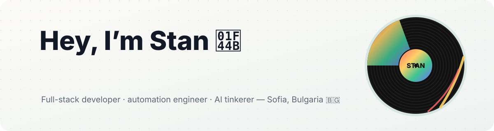
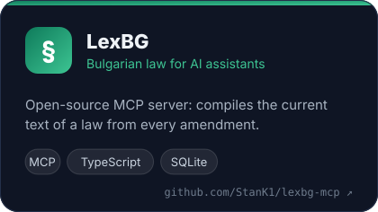
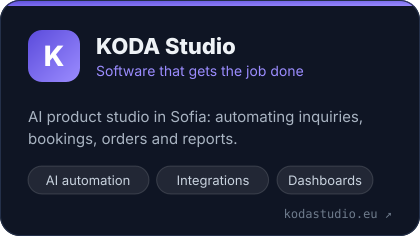
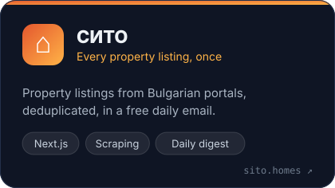
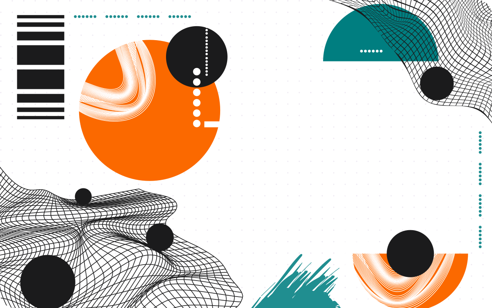
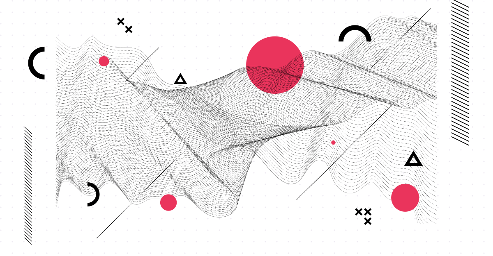

<!-- Profile README for github.com/StanK1 — lives in the repo StanK1/StanK1 -->

<picture>
  <source media="(prefers-color-scheme: dark)" srcset="assets/banner-dark.svg">
  
</picture>

<p align="center">
  <a href="https://kodastudio.eu"></a>
  <a href="https://sito.homes"></a>
  <a href="https://www.linkedin.com/in/stanislavkrastev/"></a>
  
</p>

## 👋 About me

- 🛠️ I build **web apps, automations and AI tools**, mostly with React, Next.js and TypeScript.
- 🏦 By day I keep a bank's batch jobs running on time as a **UC4 / Automic engineer** at Commerzbank DTC.
- 🚀 After hours I run **[KODA Studio](https://kodastudio.eu)**, a small AI product studio in Sofia, and build **[СИТО](https://sito.homes)**, which puts Bulgaria's property listings in one place.
- 🤖 Currently exploring **AI enablement**: MCP servers, LLM agents, and making AI answer from real sources instead of memory.
- 🎓 Studying Software Technologies and Design at the University of Plovdiv.
- 🔥 Off the keyboard I'm an artist at heart, and I **play with fire**. Literally.


## 🚀 Things I'm building

<p align="center">
  <a href="https://github.com/StanK1/lexbg-mcp"></a>
  <a href="https://kodastudio.eu"></a>
  <a href="https://sito.homes"></a>
</p>

## 🎨 Design corner

I care how things look as much as how they work.



<p align="center"></p>

## 🧰 What I reach for

**Design** <br>


**Frontend** <br>


**Mobile** <br>


**Backend & data** <br>


**Automation & AI** <br>


**Ship it** <br>


<p align="center"></p>

## ⚡ Right now

```ts
const stan = {
  location: "Sofia, Bulgaria 🇧🇬",
  building: ["LexBG", "KODA Studio", "СИТО"],
  learning: ["AI agents", "MCP", "evals that keep AI honest"],
  dayJob: "keeping batch jobs on schedule (UC4 / Automic)",
  offline: ["art 🎨", "playing with fire 🔥"],
  askMeAbout: "React, automation, or how AI can read the law",
};
```

## 📊 GitHub, in numbers


<picture>
  <source media="(prefers-color-scheme: dark)" srcset="https://raw.githubusercontent.com/StanK1/StanK1/output/snake-dark.svg">
  
</picture>

<p align="center"><sub>Built with curiosity, too many browser tabs and a little bit of fire. Thanks for stopping by ✌️</sub></p>
